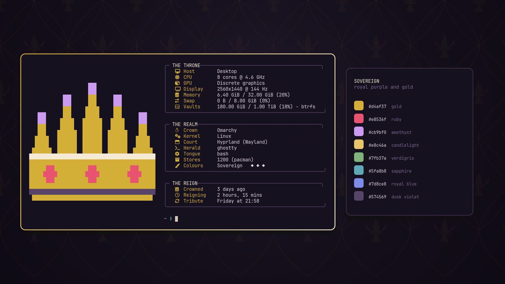
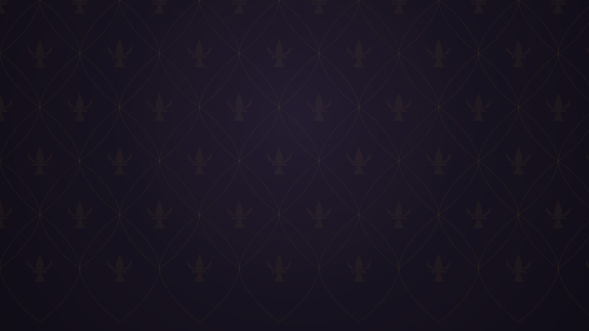

# Sovereign for Omarchy

A dark [Omarchy](https://omarchy.org) theme: a deep purple ground with a gold accent, ruby and amethyst. It was made to go with the [king rice](https://github.com/YassineSawahi/omarchy-king-rice): under it the pixel crown renders in gold, with ruby gems on the band and amethysts on the spikes.



## Install

```bash
omarchy theme install https://github.com/YassineSawahi/omarchy-sovereign-theme
```

Cycle the wallpapers with `omarchy theme bg next`.

## Wallpapers

| | |
|---|---|
|  |  |
|  |  |
|  |  |

Every wallpaper (a castle, regalia, damask, velvet and heraldry) is drawn by a script from the theme's own colours, so the art sits inside the palette instead of next to it.


## Palette

Every colour reads at 4.5:1 or better against the background, except brown (3.7:1) and the muted grey (2.2:1), which is meant for de-emphasised text.

| Slot | Value | Contrast |
|---|---|---|
| background | `#17121f` | |
| foreground | `#ded3e8` | 12.77 |
| accent | `#d4af37` | 8.74 |
| red | `#e8536f` | 5.16 |
| orange | `#e08a4a` | 6.92 |
| yellow | `#e8c46a` | 10.97 |
| green | `#7fb37a` | 7.55 |
| cyan | `#5fa8b8` | 6.81 |
| blue | `#7d8ce8` | 5.94 |
| magenta | `#b57edc` | 6.11 |
| brown | `#8a6a48` | 3.71 |
| bright red | `#ff5c78` | 6.17 |
| bright yellow | `#f6d98a` | 13.31 |
| bright green | `#9ccf96` | 10.31 |
| bright cyan | `#7fc6d6` | 9.58 |
| bright blue | `#9aa8ff` | 8.24 |
| bright magenta | `#cb9bf0` | 8.30 |
| muted | `#574569` | 2.15 |
| selection | `#2e2340` | text on it 10.2 |

Focused windows get a gold-to-ivory border. Icons are `Yaru-purple`.

## How it works

This repo is only files: a palette, the wallpapers and a few images. Omarchy does the rest, on your PC. Nothing runs and nothing goes over the network once it's cloned.

- `omarchy theme install` clones the repo into `~/.config/omarchy/themes/sovereign` and switches to it.
- Switching copies the theme into `~/.local/state/omarchy/current/theme` and renders every app's config (terminals, Hyprland, Neovim, btop, VS Code, the bar) from `colors.toml` through Omarchy's own templates. The theme ships no app configs of its own.
- `icons.theme` names the icon theme, `Yaru-purple`, which Omarchy sets for GTK apps.
- `backgrounds/` holds the wallpapers. `omarchy theme bg next` cycles through them.
- `preview.png` is what Omarchy's theme picker shows.
- `unlock.png` is the logo for the boot screen where you type your disk password, and `preview-unlock.png` its preview. They're only used if you pick Sovereign under Omarchy menu → Appearance → Unlock, which asks for your password because the boot screen is system-wide.

## License

MIT. The wallpapers are original, drawn by a script from the palette.
